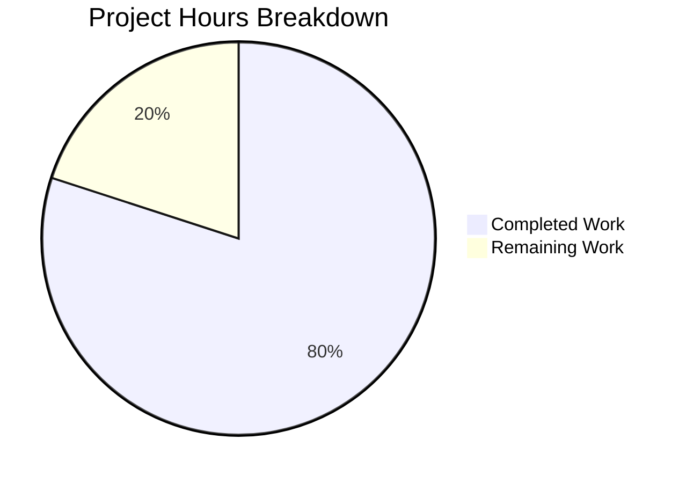

# 1. Executive Summary

## 1.1 Project Overview

This release adds one HTTP endpoint to the existing task-manager application: `GET /good-evening`, answering `200` with the plain-text body `Good evening` under exactly `Content-Type: text/plain`. It is registered in the application factory beside the six routes the API already served, so it inherits the product's single error contract and its response-hardening headers by registration rather than restating either. The change is purely additive — no existing route, handler, use case, adapter, configuration reader or dependency was altered, and start-up, bind and logging behaviour is untouched. It has no rendered surface, so the web client behaves exactly as before.

## 1.2 Completion Status



| Metric | Hours |
| --- | --- |
| Total Hours | 27.5 |
| Completed Hours (AI + Manual) | 22.0 |
| Remaining Hours | 5.5 |

**Completion: 80.0 %**, computed from delivered scope alone as `22.0 / (22.0 + 5.5) × 100`: the endpoint, its registration, its suite and the verification of all three. Remaining hours are the three path-to-production items in Section 1.4.

## 1.3 Key Accomplishments

- `GET /good-evening` answers `200` with exactly `Good evening` under `Content-Type: text/plain`, verified over HTTP and in a browser.
- Registration in the factory gives the route the app-wide hardening headers and the single error contract.
- Path exactness: the query string is ignored; a trailing slash, a case change and the `/api` prefix answer the not-found envelope.
- Method posture: `GET` only, no HEAD twin, no `405`.
- All six pre-existing endpoints keep their documented contracts from byte-identical code.
- One suite of 7 cases and 39 assertions covers the contract, path, methods, preserved endpoints and a socket-free start.
- The gate set passes: 750 tests across three tiers plus type-check, lint, build, architecture rules, audit and coverage thresholds.
- Process posture unchanged: one start-up record, loopback-only bind, no per-request logging.

## 1.4 Critical Unresolved Issues

Open items: **3 of 23 scoped items** — all 20 deliverable requirements are complete; the three path-to-production gaps below remain, and none affects the verified behaviour.

| Issue | Impact | Owner | ETA |
| --- | --- | --- | --- |
| The repository's API summary table does not list the endpoint | An operator browsing the documented endpoint set will not discover the route | Repository owner | 1.0 h |
| The endpoint sits outside the proxied prefix, so no browser-origin caller reaches it | A client-side consumer fails until the proxy covers the path or the route moves under `/api` | Repository owner | 1.5 h |
| The declared floor (`node >=20.19.0`) cannot be satisfied by the installed closure, which requires `>=22` | An operator on the declared minimum runs an unsupported configuration; that line has never been exercised | Repository owner | 3.0 h |

## 1.5 Access Issues

No access issues identified. The application needs no credential, secret, external service or container; it reads three defaulted environment variables and binds loopback only.

## 1.6 Recommended Next Steps

1. **[High]** Reconcile the declared runtime floor with the installed closure — exercise the suites on the declared line, or raise `engines.node`.
2. **[Medium]** Decide browser-origin reachability and, if a client-side caller is needed, extend the proxy to cover the path.
3. **[Medium]** Add the endpoint to `README.md`'s API summary table so documentation matches the served set.
4. **[Medium]** Gate releases on the existing sequence — type-check, lint, tests, coverage, build, browser tier.

# 2. Project Hours Breakdown

## 2.1 Completed Work Detail

| Component | Hours | Description |
| --- | --- | --- |
| Greeting route module (`backend/src/interface/http/goodEveningRoutes.ts`) | 4.0 | The route definition and handler for `GET /good-evening`: the exact path, the explicitly stated `text/plain` media type and the literal 12-byte body, with no validation, logging, store access or error handling, matching the established per-family module shape. |
| Registration and route inventory (`backend/src/interface/http/buildApp.ts`) | 3.0 | The sibling import, the registration call appended downstream of the error-handling installation, and the count-bearing comment statements that now describe three route modules and seven routes, with the six `/api` routes distinguished from the unprefixed greeting route. |
| Integration suite (`backend/tests/integration/http/goodEvening.test.ts`) | 9.0 | Seven cases and 39 assertions over the real composed application: wire contract by exact equality, consecutive-request identity, path matching, `POST` and `HEAD` misses, the preserved endpoints in the same composition, and a start with every route registered but no socket bound, over a per-test temporary database. |
| Verification of the delivered surface | 6.0 | The repository's gates (type-check, lint, both workspaces' suites, coverage thresholds, architecture rules, dependency audit, clean build), a live battery over the new route and every preserved endpoint, the preserved browser journeys and the browser acceptance tier. |
| **Total** | **22.0** | |

## 2.2 Remaining Work Detail

| Category | Hours | Priority |
| --- | --- | --- |
| Runtime floor reconciliation: the declared `engines.node` (`>=20.19.0`) cannot be satisfied by the installed dependency closure, which requires `>=22` — either exercise the suites on the declared line or raise the declaration | 3.0 | High |
| Browser-origin reachability: decide whether a client-side consumer will call the endpoint and, if so, extend the development and preview proxy (or relocate the route under `/api` as a contract change) | 1.5 | Medium |
| API documentation currency: add the endpoint to the API summary table in `README.md` so the documented set matches the seven routes the server serves | 1.0 | Medium |
| **Total** | **5.5** | |

Completed work traces to the delivered endpoint, its registration, its coverage and the gates that verify them; remaining work traces to the runtime support envelope, the endpoint's reachability from a browser origin and its documentation. Completed 22.0 h plus remaining 5.5 h gives the 27.5 total project hours and the 80.0 % completion stated in Section 1.2.

# 3. Test Results

| Area / Category | Framework | Tests | Passed | Failed | Coverage | What This Proves |
| --- | --- | --- | --- | --- | --- | --- |
| Greeting route integration suite — the delivered feature | Vitest 4.1.12 | 7 | 7 | 0 | Route module fully exercised; the interface layer measures 95.72 % lines | The endpoint's exact wire contract (status, `text/plain` by equality, literal 12-byte body), path exactness, the method posture with no HEAD twin or `405`, the preserved endpoints in the same composition and a socket-free start. |
| Task HTTP contract — preserved | Vitest 4.1.12 | 103 | 103 | 0 | Interface layer 95.72 % lines | The five task routes' complete contract: creation, read, update, toggle, delete, validation envelopes, filtering, sorting and transport-limit handling. |
| Liveness and process lifecycle — preserved | Vitest 4.1.12 | 7 | 7 | 0 | 100 % on the liveness module | The health route's exact body plus a real process start: exactly one start-up record naming address, database path and schema version, and a cross-process read-back. |
| Domain and application units — preserved | Vitest 4.1.12 | 357 | 357 | 0 | `src/domain` 100 % statements, 99.02 % branches; `src/application` 100 % on all four metrics — both gated | Task validation, entity rules and all six use cases, including the rejection paths clients depend on. |
| Persistence, migrations and list performance — preserved | Vitest 4.1.12 | 51 | 51 | 0 | `src/infrastructure` 95 % statements / 94.82 % lines | The SQLite adapter's behaviour, boot migration idempotence and rollback position, and the listing query's behaviour under load. |
| Architecture and dependency rules | Vitest 4.1.12 + dependency-cruiser 17.4.3 | 2 | 2 | 0 | 51 modules and 118 dependencies cruised, no violation | Layer boundaries hold with the new module in place: one added one-way edge from the factory to the route module and none across a layer. |
| Frontend components and state — preserved | Vitest 4.1.12 (jsdom) | 191 | 191 | 0 | Frontend all files 87.69 % statements / 87.67 % lines | List rendering, the create and edit form, filters and sorting, selectors, the API client and the task hook. |
| Browser acceptance tier — preserved | Playwright 1.64.1 (Chromium) | 32 | 32 | 0 | Not measured | The user journeys end to end: create, edit, complete, delete with confirmation, filter, sort, persistence across a reload and the responsive layouts. |

**Totals observed: 750 tests, 750 passed, 0 failed** — 527 in the backend workspace, 191 in the frontend workspace and 32 in the browser tier, with backend coverage at 94.26 % statements and 94.15 % lines. Every count above is from a run of this tree, not from a plan.

**Not Covered**

- **The endpoint through a browser origin.** The path sits outside the prefix the development and preview servers proxy, so no browser-tier test and no client journey reaches it. Its automated coverage is the in-process suite plus direct calls to the API port; a human wanting browser-origin confidence must first extend the proxy (Section 2.2).
- **The new module's comments and the factory's corrected prose.** No test executes comment text and no doc-lint rule exists; those lines are covered by the compiler and the linter only.
- **The interface layer's coverage as a gate.** The enforced thresholds measure `src/domain/**` and `src/application/**`; the new module's coverage is measured (95.72 % lines for the layer) but not enforced, so a future change there could reduce it without failing the gate.
- **The new suite's types.** The test tree sits outside every type-check program by existing configuration, so a type error in it surfaces only when the runner executes it — which the focused run and the workspace run both do.
- **The declared runtime line.** Nothing has run on the declared `>=20.19.0` floor (Section 2.2); every count above comes from the installed 22.x line.

# 4. Runtime Validation & UI Verification

- ✅ **API start-up.** `npm start` and `node backend/dist/main.js` each print exactly one record naming the loopback address, the database path and `schemaVersion: 1`; the bind is loopback-only (non-loopback and IPv6 connections refused); the development origin serves the built bundle and proxies `/api` to the live API.
- ✅ **`GET /good-evening`.** 200 with `content-type: text/plain` exactly (no charset parameter), `content-length: 12`, body `Good evening` with no trailing byte, plus `x-content-type-options: nosniff`, `x-frame-options: DENY` and `cache-control: no-store` — reproduced on the documented default port 3000, on the built artifact, and in a browser (which renders the document as `text/plain` with a 12-byte body).
- ✅ **Path behaviour.** `/good-evening?x=1` answers 200 with the same 12-byte body; `/good-evening/`, `/Good-Evening`, `/GOOD-EVENING`, `/api/good-evening` and an unknown path each answer the not-found envelope naming that path.
- ✅ **Method behaviour.** `POST`, `PUT`, `PATCH`, `DELETE`, `OPTIONS` and `HEAD` on the path answer the not-found envelope naming the method; no response anywhere carried `405` or an `Allow` header, and the `GET` following a `HEAD` still answered 200.
- ✅ **Preserved API surface.** `/api/health` → `{"status":"ok"}`; task list, create, read, patch and delete → 200 / 201 / 200 / 200 / 204; an unknown or deleted identifier → 404 with the domain message; an unmatched path and `/hello-world` → the product's unchanged 404 envelope; an invalid write payload → 400 with field-keyed messages.
- ✅ **Preserved process posture.** One log line across the entire request battery — per-request logging stays off and the new route adds no output of its own.
- ✅ **Preserved user journeys in a browser.** Empty state, two tasks created through the form with priority and due date, an inline edit reflected in the list, the completion toggle, priority and status filters, three sort orders, deletion behind a confirmation dialog, and persistence across a reload — all observed, with zero console errors or warnings and zero unexpected responses at 400 or above.
- ✅ **Browser acceptance tier.** 32 tests across 6 specs pass on the built tree in 13.1 s.
- ⚠ **The new endpoint through a browser origin.** The development origin answers its own SPA shell for the path instead of the greeting — the deliberate consequence of keeping the contracted path while the proxy forwards `/api` only (Section 2.2).
- ⚠ **The declared runtime floor.** Nothing was exercised below the installed 22.x line, so the declared `>=20.19.0` support envelope remains unproven (Section 2.2).

Never exercised at runtime: any authenticated flow (the product has no identity layer, and the endpoint reads nothing from the request), sustained volumetric or many-thousand-connection load, and any deployment, container or pipeline path, none of which exists in the repository. The endpoint's own failure path is unreachable by design: it holds no store, calls no use case and takes no dependencies, so no request can drive it into the application's internal-error branch.

# 5. Compliance & Quality Review

## 5.1 Compliance Matrix

Legend: ● Completed — dark blue `#5B39F3`; ○ Remaining — white `#FFFFFF`.

| Deliverable | Quality / compliance benchmark | Verified status | Progress |
| --- | --- | --- | --- |
| Exact wire contract for `GET /good-evening` | Status, media type and body asserted by exact equality rather than by containment | Pass — 200, `text/plain`, 12-byte body, over HTTP and in a browser | <span style="color:#5B39F3">●</span> Completed |
| Registration in the application factory | One composition point; registration downstream of the error-handling installation; no initialization edit | Pass — `backend/src/interface/http/buildApp.ts:141-147` | <span style="color:#5B39F3">●</span> Completed |
| Additive-only change and preserved endpoints | No existing route, handler, use case, adapter or configuration reader altered | Pass — one modified file (two code lines plus comment text) and two created files | <span style="color:#5B39F3">●</span> Completed |
| Preserved process posture | One start-up record, loopback-only bind, no per-request logging | Pass — one record per boot; one log line across the whole request battery | <span style="color:#5B39F3">●</span> Completed |
| Preserved HTTP method processing | `GET` only, no HEAD twin, no `405` | Pass — six other methods answered by the not-found envelope; no `Allow` header anywhere | <span style="color:#5B39F3">●</span> Completed |
| Inherited error contract and response hardening | Shared behaviour reached by registration, never restated per route | Pass — no `try`/`catch`, header list or error body in the module | <span style="color:#5B39F3">●</span> Completed |
| Dependency and configuration surface | No package, lockfile, environment variable or build input changed | Pass — every manifest and configuration file unchanged | <span style="color:#5B39F3">●</span> Completed |
| Test coverage in the repository's own system | One suite per route family, contract pinned by exact equality, isolated per-test store | Pass — 7 cases, 39 assertions, temporary database per test, no socket bound | <span style="color:#5B39F3">●</span> Completed |
| Repository gates | Type-check, lint, tests, build, architecture rules, dependency audit, coverage thresholds | Pass — every gate exits 0; 750 tests pass across three tiers | <span style="color:#5B39F3">●</span> Completed |
| Documentation currency | The documented endpoint set should match the served one | Gap — the API summary lists six routes and not this one | <span style="color:#FFFFFF">○</span> Remaining (1.0 h) |
| Browser-origin reachability | The endpoint reachable from the same origin as the rest of the API | Gap, accepted by decision — the path is outside the proxied prefix | <span style="color:#FFFFFF">○</span> Remaining (1.5 h) |
| Declared runtime support envelope | The declared `engines.node` range satisfiable by the installed closure | Gap — a transitive dependency requires `>=22`, the manifest declares `>=20.19.0` | <span style="color:#FFFFFF">○</span> Remaining (3.0 h) |

## 5.2 AAP & Rule Divergences and Gaps

| What the AAP / Rule Required | What Was Delivered Instead | Why It Diverged | Impact | Remediation |
| --- | --- | --- | --- | --- |
| Uniform application of the project's established standards (Rule 3, "21-Oct"); every other route family sits under `/api` | An unprefixed route: `app.get('/good-evening', …)` at `backend/src/interface/http/goodEveningRoutes.ts:20` | The published wire contract fixes `/good-evening` exactly and its acceptance gate calls the API port, so the contract outranks the convention — **Sanctioned** | The endpoint is outside the proxied prefix and outside any future `/api` allowlist | None; the departure and its reason are stated in the module header |
| Preservation case titled as the plan's case inventory words it ("Leaves the existing endpoints serving…") | `leaves the task and liveness endpoints serving in the same composition` (`backend/tests/integration/http/goodEvening.test.ts:375`) | The plan's normative requirement is a lowercase declarative sentence stating observable behaviour, and "existing" was relative to the endpoint's arrival | None — the case pins exactly the endpoints the inventory names | None |
| The new code uses only framework APIs the existing handlers already call | `reply.type('text/plain')`, which no other handler calls (`backend/src/interface/http/goodEveningRoutes.ts:21`) | The contract names exactly `text/plain`; the framework's default for a string body carries a charset, so the explicit call is mandatory and outranks the inventory prose — **Sanctioned** | One framework call no sibling route uses | None; removing it would break the contracted media type |
| Preserve the existing `GET /hello-world` endpoint's `Hello world` response | Nothing created; `GET /hello-world` answers the product's unchanged 404 envelope | No such endpoint, `server.js` or `/hello` route exists anywhere in the repository, and the request asked for that endpoint to be preserved rather than added — **Sanctioned** | A reader validating the original request's literal wording looks for an endpoint deliberately never added | None; adding it would be a separate, unrequested feature |
| The new endpoint is covered by a test at the request's stated `test/good-evening.test.js` (JavaScript) | `backend/tests/integration/http/goodEvening.test.ts`, Vitest over TypeScript | The repository has no root `test/` directory and no JavaScript suite; its own requirement to use the same framework and layout as the existing tests governs — **Sanctioned** | None | None |
| No documentation file changes; the request permitted only routing configuration and handler definitions | `README.md` unchanged, so its API summary (`README.md:315-320`) still lists six routes | The request's own "Modify Only" list excludes documentation — **Sanctioned** | An operator browsing the API table will not discover the endpoint | Add the row (Section 2.2, 1.0 h) |
| Configuration changes are out of scope; the contracted path is unprefixed | The development and preview proxy still forwards `/api` only (`frontend/vite.config.ts:52-57`) | Extending the proxy is a configuration change the request forbids — **Sanctioned** | No browser-origin caller can reach the endpoint; the dev origin answers its own SPA shell for the path | Extend the proxy or relocate the route if a client-side caller is required (Section 2.2, 1.5 h) |
| Declared runtime support: `engines.node >=20.19.0` with Node 22.x installed | The declaration is untouched and has never been exercised; the installed closure contains `cookie@2.0.1`, which requires `>=22` | Pre-existing item of the delivered system, outside this change's surface; adding a route neither raises nor resolves it | An operator on the declared minimum runs an unsupported configuration | Reconcile the declaration with the closure (Section 2.2, 3.0 h) |

**The unprefixed path against the repository's convention (row 1, sanctioned).** Rule 3 asks that the standards a project has already established be applied uniformly, and this repository's established convention is that every route family lives under `/api`. The greeting route does not: it is registered at `/good-evening`, exactly as the request fixed it twice, including in its own acceptance command against the API port. The contract is the higher source, so the path stands and the module header states the departure and its reason in the code's own terms (`backend/src/interface/http/goodEveningRoutes.ts:11-13`). The practical consequence is recorded rather than hidden: the endpoint is reachable on the API port and not through the browser origin, and any future proxy or ingress allowlist that covers `/api` only will silently not cover it.

**The preservation case's title (row 2).** The plan's case inventory describes the case as leaving "the existing endpoints" serving; the delivered title names the task and liveness endpoints instead, which is what the case actually asserts — `/api/health`, `/api/tasks` and an unmatched path in one composition. The wording follows the plan's normative requirement that every case name be a lowercase declarative sentence stating observable behaviour, and the inventory is a description of what each case is for rather than the source of its title string. No case was dropped or weakened: all seven planned cases are present, the exact-path case pins three additional miss forms, and the contract case pins the hardening headers on the route's own response.

**The explicit media type (row 3, sanctioned).** The plan's dependency section states that the new code should use only framework APIs the existing handlers already call, and `reply.type('text/plain')` is called by no sibling handler. That is deliberate: with no explicit content type the framework answers a string payload as `text/plain; charset=utf-8`, which is not the media type the contract names. The same plan makes the explicit call mandatory in its response-contract decision, which outranks the inventory prose, so the code keeps the call and the suite asserts the header by exact equality (`backend/tests/integration/http/goodEvening.test.ts:271`) — which is what makes the call's removal fail loudly rather than pass quietly. No rule is departed from by this call.

**The `/hello-world` premise (row 4, sanctioned).** The request described a tutorial server whose `/hello-world` endpoint returns `Hello world` and asked that it be preserved. No such endpoint, file or `hello` match exists anywhere in this repository: the checkout is the Fastify/SQLite task manager, and the running API answers that path with its own not-found envelope — which is exactly what a request for preservation asks it to keep doing. The discrepancy was resolved in favour of the code, the third declared test was recorded as unsatisfiable, and the preservation requirement is carried instead by the case that pins the endpoints that do exist. A reader validating the original wording must not expect the endpoint to be present.

**The suite's location (row 5, sanctioned).** The request named `test/good-evening.test.js` and also required the same testing framework and conventions as the existing tests. Those two cannot both hold: the repository has no root `test/` directory and no JavaScript suite anywhere, and every backend suite is TypeScript under `backend/tests/**`, discovered by the configured include glob. The suite therefore lives beside the route module it pins, alongside the sibling suites for the liveness and task families, whose structure, helper set and naming it mirrors. Nothing of the request's intent is lost: the contract, the preserved endpoints and the clean start are all pinned by a suite that runs under the repository's own test command.

**The endpoint's absence from the API summary (row 6, sanctioned).** The request's "Modify Only" list names routing configuration and handler definitions and permits nothing else, so `README.md` was left untouched and its API summary still lists the six routes the API served before this change. That is a recorded boundary rather than an oversight, but the consequence matters to a reader: the repository's own user-facing endpoint summary is now one route behind what the server serves, and an integrator who consults only that table will not learn the endpoint exists — even though it is fully described in the module header, in the suite's header and by its own contract. Closing the gap is a one-hour documentation edit, carried in Section 2.2.

**The proxy prefix (row 7, sanctioned).** Because the path is exactly what the contract fixes and extending the proxy is a configuration change the request excludes, the development and preview servers continue to forward only `/api`. A browser therefore cannot call the endpoint: the development origin answers its own single-page-app shell for the path, while the same path on the API port answers the greeting. The endpoint is complete as an API surface — it was verified over the wire on the documented default port, and no client code calls it — but any future client-side consumer will fail until the proxy covers the path or the route moves under `/api`. Both are deliberate changes, so the decision belongs to the repository owner (Section 2.2, 1.5 h).

**The declared runtime floor (row 8).** The manifest declares `node >=20.19.0`, and the installed closure cannot honour it: `cookie@2.0.1`, reached through the framework's own request-injection dependency, declares `engines.node >=22`. Nothing has ever exercised the declared line, so the lower bound is a claim rather than a verified support envelope, and an operator who installs the declared minimum may find the closure refuses to load. Adding a route neither raised nor altered this pre-existing item, which is why it appears as remaining work (3.0 h) rather than as a defect of the delivered change: the remedy is to build and test on the declared line, or to raise the declaration to the line the lockfile supports.

# 6. Risk Assessment

| Risk | Category | Severity | Probability | Mitigation | Status |
| --- | --- | --- | --- | --- | --- |
| The API has no identity layer, serves plain HTTP and applies no transport hardening, so any deployment beyond the loopback bind would expose anonymous task writes | Security | High if exposed | Low while the bind stays loopback | Keep the loopback bind; terminate TLS and add an identity layer at the ingress before any network exposure | Open — accepted posture, unchanged by this release |
| The not-found envelope reflects the request path into a JSON body; a future client that renders API error text as HTML would inherit an injection sink | Security | Low | Low | Keep error text out of rendered output; escape it if it is ever displayed | Open — pre-existing, identical on every route |
| The declared runtime floor (`node >=20.19.0`) cannot be satisfied by the installed closure, which requires `>=22`, and that line has never been exercised | Integration | Medium | Medium | Reconcile the declaration with the closure, or build and test on the declared line | Open — remaining work, 3.0 h |
| No browser-origin consumer can reach the endpoint, because the development and preview servers forward only `/api` | Technical | Low | Likely if a client caller is added | Extend the proxy or relocate the route before a client-side consumer is built | Open — remaining work, 1.5 h |
| The endpoint is the API's only unprefixed path, so prefix-based allowlists and router options that assume `/api` do not cover it | Technical | Low | Possible | Treat the path as contracted; the module header states the basis, and any ingress allowlist must name it explicitly | Open — accepted by decision |
| Observability is thin: no metrics, tracing or request correlation, and a log level above `info` suppresses the single start-up record | Operational | Medium | Possible | Deploy at the documented default level; add a request identifier or a stop record if operations requires one | Open — pre-existing posture |
| No graceful shutdown and no stop record: a supervisor cannot distinguish an intended stop from a crash | Operational | Low | Likely | Treat process exits as supervised restarts; add a shutdown record if operability requires it | Open — pre-existing posture |
| The release path is manual: no pipeline enforces the suites, the runtime floor or the coverage gate, and test code sits outside every type-check program while the interface layer sits outside the enforced coverage thresholds | Operational / Technical | Medium | Likely | Put the existing gate sequence (type-check, lint, tests, coverage, build, browser tier) behind the release process | Open — pre-existing posture |

# 7. Visual Project Status


Colours: Completed work — dark blue `#5B39F3`; remaining work — white `#FFFFFF`.

| Status | Hours | Share |
| --- | --- | --- |
| Completed work | 22.0 | 80.0 % |
| Remaining work | 5.5 | 20.0 % |
| **Total** | **27.5** | **100 %** |

Remaining work by category, from Section 2.2:

| Category | Hours | Priority |
| --- | --- | --- |
| Runtime floor reconciliation | 3.0 | High |
| Browser-origin reachability | 1.5 | Medium |
| API documentation currency | 1.0 | Medium |
| **Total** | **5.5** | |

# 8. Summary & Recommendations

The delivered capability is small, sharp-edged and fully verified: `GET /good-evening` answers `200` with the exact body `Good evening` under exactly `Content-Type: text/plain`, registered in the application factory beside the six routes the API already served, so it inherits the single error contract and the response-hardening headers (`nosniff`, `DENY`, `no-store`) by registration rather than restating either. Nothing else moved: no existing route, handler, use case, adapter, configuration reader, dependency or environment variable changed, and the server's start-up, bind and logging behaviour is identical to before — one start-up record per boot, a loopback-only bind, and no per-request logging. The change is accompanied by an integration suite of seven cases and 39 assertions that pins the contract by exact equality, the path's exactness, the method posture with no HEAD twin and no `405`, the preserved endpoints in the same composition, and a start with every route registered but no socket bound. Every gate over the tree exits 0, with 750 tests passing across the unit, integration and browser tiers.

Completion stands at **80.0 %** — 22.0 of 27.5 hours — computed from delivered scope alone. The completed hours are the route module, its registration and the route inventory that goes with it, the integration suite, and the verification of all three over the wire, in a browser and through the repository's gates. The remaining 5.5 hours are three path-to-production items rather than unfinished development: the declared runtime floor cannot be satisfied by the installed dependency closure, the endpoint is deliberately outside the prefix the development and preview servers proxy, and the repository's own API summary still lists six routes. All three appear in Section 1.4 with their owners and estimates, and none of them affects the verified behaviour.

The critical path to production runs through the first of those: reconcile `engines.node` with the installed closure, either by exercising the suites on the declared line or by raising the declaration to the line the lockfile supports (3.0 h), because a support envelope that has never been exercised is a claim, not a verified one. The reachability decision (1.5 h) matters only if a client-side consumer is planned — the endpoint is complete as an API surface and needs no client — and the documentation edit (1.0 h) restores the match between the documented endpoint set and the seven routes the server serves. Gating releases on the existing sequence would then keep all three from drifting: the suites, the coverage thresholds, the architecture rules and the browser tier all pass today, and none of them is currently enforced by anything but a developer's habit.

**Production readiness: ready to ship for direct API consumers, inside the existing operational model.** The delivered endpoint's contract is exact and continuously asserted, the preserved surface is verified from byte-identical code, and the operational footprint is unchanged. Two properties of the wider application remain as they were and are worth an owner's explicit decision rather than silent inheritance: the API has no identity layer and binds loopback only, so any move to a network-facing deployment must bring authentication and TLS with it; and observability consists of a single start-up record plus one line per server-side failure, with no metrics, tracing or request correlation. Neither is a property of this change, and neither blocks it.

The success metrics for the next release are simple to hold: keep the contract assertions as exact-equality checks so a media-type regression fails loudly, keep the gate sequence green with no failures or skips in any tier, keep the start-up output to exactly one record with per-request logging off, and keep the change additive — every existing endpoint's status and body unchanged. Hold those four, close the three open items, and this branch is releasable without further rediscovery.

# 9. Development Guide

### System prerequisites

- **Node.js** — the manifest declares `>=20.19.0`, but the installed dependency closure requires a higher line (`cookie`, reached through the framework, declares `>=22`). Use **Node 22.x** (verified here on v22.23.4) until the declaration and the closure are reconciled (Section 2.2).
- **npm 11.x** (declared `>=10`).
- **No database server, container, service, credential or `.env` file is required.** The API opens a SQLite file, reads its three environment variables from the real environment, and falls back to documented defaults.
- **Browser tier only:** a Chromium build for Playwright. It is already present in the shared browser cache; `npx playwright install --with-deps chromium` is a no-op here.

### Environment setup and dependency installation

```bash
# from the repository root — one lockfile, two workspaces (backend + frontend)
npm ci
```

There is nothing else to configure. If you do set environment variables, these are the only ones the application reads:

| Variable | Default | Effect |
| --- | --- | --- |
| `PORT` | `3000` | The API's listen port; an absent, empty, non-numeric or out-of-range value falls back to 3000, and the Vite proxy target follows the same rule |
| `DATABASE_PATH` | `./data/todo.db` (relative to the process working directory, so the workspace scripts land on `backend/data/todo.db`) | The SQLite file; its parent directory is created when missing |
| `LOG_LEVEL` | `info` | The process log level; an invalid value aborts start-up with an explicit error |

### Build and start

```bash
# build both workspaces (backend tsc -> backend/dist, frontend vite -> frontend/dist)
npm run build

# start the built API, exactly as the product starts it
PORT=3000 DATABASE_PATH=./backend/data/todo.db LOG_LEVEL=info npm start

# or run the source with reload during development
PORT=3000 DATABASE_PATH=./backend/data/todo.db LOG_LEVEL=info npm run dev --workspace @todo/backend

# both halves together (API with reload plus the Vite dev server)
npm run dev

# frontend on a port of your own (the dev and preview ports are host-global)
npm run dev --workspace @todo/frontend -- --port 5173 --strictPort
npm run preview --workspace @todo/frontend -- --port 4173 --strictPort
```

Two reachability notes that catch people out: the **API binds the IPv4 loopback only**, so call it at `127.0.0.1`; the **Vite dev and preview servers bind the IPv6 loopback**, so open them at `localhost`. The root-level form `npm run preview -- --port <p>` does *not* forward the port — use the `--workspace` form shown above.

### Verification

```bash
# the API prints exactly one line on start-up and nothing per request
# {"level":30,...,"address":"127.0.0.1:3000","databasePath":"...","schemaVersion":1,"msg":"API listening"}

curl -sf http://127.0.0.1:3000/api/health        # -> {"status":"ok"}

# the delivered endpoint: status, media type, headers and exact body
curl -i http://127.0.0.1:3000/good-evening
# HTTP/1.1 200 OK
# content-type: text/plain
# x-content-type-options: nosniff
# x-frame-options: DENY
# cache-control: no-store
# content-length: 12
#
# Good evening

curl -s http://127.0.0.1:3000/good-evening | od -c   # 12 bytes, no trailing newline
```

### Example usage

```bash
# the greeting route, exactly as contracted
curl -s http://127.0.0.1:3000/good-evening
# Good evening

# a method the route does not implement answers the not-found envelope, never 405
curl -s -X POST http://127.0.0.1:3000/good-evening
# {"error":{"code":"NOT_FOUND","message":"No route matches POST /good-evening","fields":{}}}

# HEAD of the route has no twin, so it is answered the same way and carries no body
curl -s -I http://127.0.0.1:3000/good-evening | head -2

# the preserved task surface, unchanged
curl -s http://127.0.0.1:3000/api/tasks
curl -s -X POST -H 'content-type: application/json' \
  -d '{"title":"write the docs","priority":"high"}' \
  http://127.0.0.1:3000/api/tasks
```

### Tests and gates

```bash
npm test                 # backend then frontend suites
npm run test:coverage    # the same suites with the domain/application thresholds enforced
npm run typecheck        # backend program plus both frontend programs
npm run lint             # eslint over the whole repository

# one backend suite, with its case titles printed
cd backend && npx vitest run tests/integration/http/goodEvening.test.ts --reporter=verbose

# architecture rules, as the suite that enforces them or the cruiser itself
cd backend && npx vitest run tests/architecture/dependencyRules.test.ts
npx --no-install depcruise backend/src frontend/src --config .dependency-cruiser.cjs

# browser tier (it starts both servers itself; give it ports you own)
PORT=3000 VITE_DEV_PORT=5173 npm run test:e2e

# security gate — no audit script exists in the repository
npm audit --audit-level=high
```

### Troubleshooting

| Symptom | Cause | Resolution |
| --- | --- | --- |
| `EADDRINUSE` naming an address, or a Vite port collision | Ports are host-global | Pick another port and pass `--strictPort` to Vite so a collision fails loudly rather than silently shifting |
| Start-up aborts with a level error | `LOG_LEVEL` is not a level the logger accepts | Set a valid level, or leave it unset for the documented default |
| Start-up aborts with `unable to open database file` | `DATABASE_PATH` names a directory, or its parent is not writable | Point it at a file path whose parent can be created |
| The greeting route returns 404 for a path you expected to work | The route matches its path exactly | Use `/good-evening`; a trailing slash, a different case or the `/api` prefix all miss, and the query string is ignored |
| `405` expected for a wrong method | The product defines no `405` by design | A `POST` or `HEAD` of the route answers the 404 envelope naming the method — that is the contract |
| Nothing is logged while requests are served | Per-request logging is disabled instance-wide | Expected: the process writes one start-up record and one line per server-side failure |
| The greeting path returns the app's HTML shell in the browser | The endpoint is outside the prefix the dev and preview servers proxy | Call it on the API port, or extend the proxy first (Section 2.2) |
| `npx depcruise …` exits 0 without analysing anything | In a checkout with no `node_modules`, `npx` can resolve an unrelated placeholder package of the same name | Always use `npx --no-install depcruise …` or run the architecture suite through `npm test` |
| Data looks stale | The store is a single file plus its write-ahead sidecars | Delete `backend/data/todo.db` and its `-wal`/`-shm` siblings to reset; the next start re-migrates |

# 10. Appendices

## A. Command Reference

| Command | What it does |
| --- | --- |
| `npm ci` | Installs both workspaces from the single lockfile (fresh clone only) |
| `npm run build` | Builds the backend with `tsc` into `backend/dist` and the frontend with Vite into `frontend/dist` |
| `npm start` | Starts the built API (`node dist/main.js`) |
| `npm run dev --workspace @todo/backend` | Starts the API from source with reload |
| `npm run dev` | Starts the API and the Vite dev server together |
| `npm run dev --workspace @todo/frontend -- --port <p> --strictPort` | Starts the frontend dev server on a chosen port |
| `npm run preview --workspace @todo/frontend -- --port <p> --strictPort` | Serves the built frontend bundle, with the same `/api` proxy |
| `npm test` | Runs the backend suite then the frontend suite |
| `npm run test:coverage` | The same suites with the domain/application coverage thresholds enforced |
| `cd backend && npx vitest run tests/integration/http/goodEvening.test.ts --reporter=verbose` | Runs one backend suite and prints its case titles |
| `PORT=<api> VITE_DEV_PORT=<web> npm run test:e2e` | Runs the Playwright browser tier, starting both servers itself |
| `npm run typecheck` | Type-checks the backend and both frontend programs |
| `npm run lint` | Runs ESLint over the repository in check mode |
| `npx --no-install depcruise backend/src frontend/src --config .dependency-cruiser.cjs` | Runs the architecture rules directly |
| `npm audit --audit-level=high` | The security check bound to the release gate |

## B. Port Reference

| Surface | Default | Notes |
| --- | --- | --- |
| API | `3000` (`PORT`) | Binds `127.0.0.1` only — call it at that address |
| Vite dev server | `5173`, overridable with `--port` | Binds the IPv6 loopback — open it at `localhost` |
| Vite preview server | `4173`, overridable with `--port` | Same bind and proxy behaviour as the dev server |
| Browser tier | `PORT` and `VITE_DEV_PORT` for the two servers it starts | Pass both so the run uses ports you own |

All three ports are host-global: on a shared machine, give each run its own block and pass `--strictPort` so a collision fails loudly.

## C. Key File Locations

| Path | Role |
| --- | --- |
| `backend/src/interface/http/goodEveningRoutes.ts` | The delivered route definition and handler |
| `backend/src/interface/http/buildApp.ts` | The application factory: imports, registration site, shared hook and route inventory |
| `backend/tests/integration/http/goodEvening.test.ts` | The integration suite for the endpoint |
| `backend/src/interface/http/errorMapper.ts` | The single error contract and the response-hardening header set |
| `backend/src/interface/http/taskRoutes.ts`, `healthRoutes.ts` | The preserved route families |
| `backend/src/main.ts` | The composition root: configuration readers, composition, bind and the start-up record |
| `frontend/src/api/client.ts` | The client's only route to the API, through the relative `/api` base |
| `frontend/vite.config.ts` | The dev server, its proxy prefix and the frontend test configuration |
| `backend/vitest.config.ts` | Backend test discovery and the enforced coverage thresholds |
| `playwright.config.ts` | The browser tier's servers, readiness probe and settings |
| `.env.example`, `README.md` | The documented configuration surface and the API summary table |

## D. Technology Versions

| Component | Version |
| --- | --- |
| Node.js (installed) | v22.23.4 |
| npm | 11.21.0 |
| Fastify | 5.12.7 |
| better-sqlite3 / SQLite | 12.11.1 / 3.53.2 |
| TypeScript | 6.0.3 |
| tsx | 4.23.15 |
| Vitest / @vitest/coverage-v8 | 4.1.12 |
| Vite | 8.3.4 |
| React / React DOM | 19.3.1 |
| jsdom | 29.1.1 |
| Playwright | 1.64.1 |
| ESLint | 10.13.0 |
| dependency-cruiser | 17.4.3 |

Declared runtime floors live in `package.json` (`engines`): `node >=20.19.0`, `npm >=10`. The installed closure requires a higher Node line than the declaration, which is the first item in Section 2.2.

## E. Environment Variable Reference

| Variable | Required | Default | Read by |
| --- | --- | --- | --- |
| `PORT` | No | `3000` | The API's bind, and the Vite proxy target |
| `DATABASE_PATH` | No | `./data/todo.db`, resolved against the process working directory | The API's store |
| `LOG_LEVEL` | No | `info` | The process log level |
| `VITE_DEV_PORT` | No | — | The browser tier, to place its frontend server |

No secret, token or credential is read anywhere in the product, and no `.env` file is needed.

## F. Developer Tools Guide

- **Focused runs.** Run one backend suite by path (`npx vitest run tests/integration/http/goodEvening.test.ts`) for a fast signal; use `--reporter=verbose` when you need the case titles in the output.
- **Coverage.** `npm run test:coverage` enforces thresholds on `backend/src/domain/**` and `backend/src/application/**` only; the interface layer is measured but not gated, and the frontend reports its own coverage.
- **Architecture rules.** They run inside `npm test` through the architecture suite and can be reproduced with `npx --no-install depcruise …`; the config is `.dependency-cruiser.cjs` and today reports 51 modules and 118 dependencies with no violation.
- **Type checking.** Four programs run in `npm run typecheck`: the backend `src` program and two frontend programs. `backend/tests/**` and `e2e/**` are outside all of them by existing configuration, so their types are checked only when a runner executes them.
- **Linting.** One flat ESLint configuration covers the whole repository; run it in check mode (`npm run lint`) and never with `--fix` during verification.
- **Browser tier.** Playwright starts both servers, waits on `/api/health` before driving Chromium, and needs `PORT` and `VITE_DEV_PORT` on a shared machine.

## G. Glossary

| Term | Meaning |
| --- | --- |
| Wire contract | The externally visible response the endpoint promises: status, media type and exact body |
| Error envelope | The product's single JSON error shape: `{"error":{"code":…,"message":…,"fields":…}}` |
| HEAD twin | A framework feature that mirrors every `GET` route into a `HEAD` route; disabled instance-wide here |
| Hardening headers | The instance-wide `nosniff`, `DENY` and `no-store` headers every dispatched response carries |
| Preserved endpoint | A route that existed before this change and continues to answer from byte-identical code |
| Composed application | The real object graph — store, adapter, use cases and HTTP application — assembled by the composition root |
| Socket-free start | An application brought ready and driven in-process through request injection, binding no port |
| AAP-scoped completion | Delivered hours divided by delivered plus remaining hours, counting only the scoped work and its path to production |
