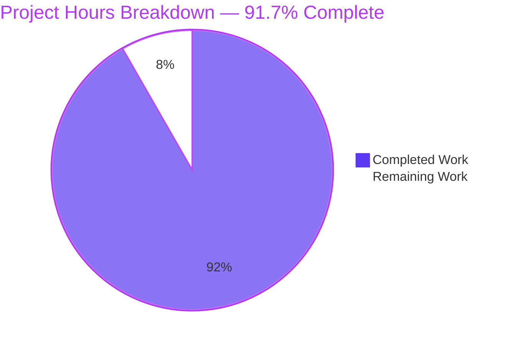

# 1. Executive Summary

## 1.1 Project Overview

A local, single-user to-do application: a React and Vite interface over a Fastify JSON API, with tasks in a SQLite file. It is layered — domain, application, infrastructure, interface — so rules, storage and interface each change or test independently. One person keeps the list locally: record a task quickly, refine it with a description, priority and due date, work from a filtered and sorted view, complete and reopen, delete behind a confirmation. No accounts, no secrets, no external service.

## 1.2 Completion Status



**91.7% complete — 366 hours delivered of 399 total, 33 hours remaining.**

| Metric | Hours |
|---|---|
| Total Hours | 399 |
| Completed Hours (AI + Manual) | 366 |
| Remaining Hours | 33 |

## 1.3 Key Accomplishments

- Task lifecycle end to end: create, edit in place, complete and reopen, confirm-then-delete.
- Server-owned filtering and sorting, total and reproducible, undated tasks last on a due-date sort.
- Persistence in a configurable SQLite file with a versioned schema, across reloads and restarts.
- Six JSON routes under `/api`, one error envelope, field-level messages, and a 500 that logs its cause while disclosing nothing.
- Layering enforced mechanically: seven dependency rules fail the suite on a forbidden import or a cycle.
- Every interface state rendered, including filtered-empty with a way out, retryable failure and a disappeared task.
- Accessibility and responsiveness measured: 320px to desktop, no horizontal scrolling, labelled and keyboard-operable controls, priority and overdue as words.
- 743 tests pass across four layers; the domain and application layers hold 100% line coverage.

## 1.4 Critical Unresolved Issues

Nine of the sixty requirements this work was scoped against remain open; each is a caveat or a verification gap, none blocks release.

| Issue | Impact | Owner | ETA |
|---|---|---|---|
| The declared Node 20.19.0 floor has never been exercised, and one transitive dependency requires Node 22 | An engine-strict install on the declared platform fails | Platform engineer | Before first release |
| 29 files are outside every TypeScript program (`backend/tests/**`, `backend/vitest.config.ts`, `playwright.config.ts`, `e2e/**`) | A type error in them surfaces only when that file runs | Backend developer | Next iteration |
| The process entry and the screen composition are the least-covered files (56.1% statements / 15.8% branches; 0%) | Startup, configuration-guard and shutdown behaviour has no assertion-level guard; the screen is untested | Backend developer | Next iteration |
| The transport-refusal reply's three response headers have no committed assertion | A later change to that path would pass the suite unnoticed | Backend developer | Next iteration |
| No graceful shutdown, and the write-ahead log's shared-memory fault has no operating policy | A stopped process leaves its sidecars; that fault ends the process instead of answering 500 | Operations | Before first release |
| Duplicated values: three client-side messages and two bounds, the failure-code and query vocabulary per side, and the port defaults in three files | Drift risk only — the values agree today | Frontend developer | Next iteration |
| The data directory and its file are created world-readable | On a shared machine another local account can read task text | Operations | Before first release |
| An in-place edit draft is not visible while a failed list load's alert stands | A draft is hidden during a failure and re-initialises from the server on retry | Frontend developer | Backlog |
| Comments in four test and end-to-end headers cite specification sections a reader cannot follow, and two exported surfaces are not enumerated where the specification places them | Reader confusion only | Tech lead | Housekeeping |

## 1.5 Access Issues

No access issues identified. The application needs no credentials, API key or third-party account, binds loopback only and makes no outbound request; a Chromium build is the only prerequisite.

## 1.6 Recommended Next Steps

1. **[High]** Run the install and full suite on the Node 20.19 line; settle the dependency declaring a higher floor.
2. **[High]** Add graceful shutdown; agree the restart policy for the storage fault.
3. **[Medium]** Bring the test, configuration and end-to-end sources into the type-check gate; cover the process entry and the screen composition.
4. **[Medium]** Single-source the duplicated values; assert the transport-refusal reply's headers.
5. **[Low]** Harden the data file's permissions; reword the four headers citing a document the repository does not carry.

# 2. Project Hours Breakdown

## 2.1 Completed Work Detail

| Component | Hours | Description |
|---|---|---|
| Workspace, toolchain and configuration | 22 | Root and workspace manifests, the single lockfile, four TypeScript configurations, the ESLint flat configuration, the seven dependency rules, the end-to-end runner configuration, `.gitignore` and `.env.example` |
| Domain layer | 24 | The `Task` entity with its defaults and three transitions, the complete field-rule set with its fixed messages, and the two domain error types |
| Application layer | 32 | The five-method persistence port, the clock port, filter and sort semantics with the total ordering and tie-break, and the six use cases |
| Infrastructure | 26 | The database opener (directory creation, five-second busy timeout, WAL and foreign keys before migration), the versioned migration runner with its newer-file refusal, the SQLite adapter with prepared statements and row mapping, and the system clock |
| HTTP interface | 34 | The application factory, the six routes, shape-only request parsing, the single error mapping, the response-hardening policy at all three emitters, and the transport-refusal reply |
| Composition root and startup configuration | 10 | `composeApp` as the only module naming concrete implementations, the environment guards, the single startup record and the guarded entry point |
| Frontend data layer | 12 | The wire types and the typed API client whose error type carries status, code and field map |
| Frontend state and presentation rules | 18 | List, loading, error and notice state, the filters and five actions with a refetch after every mutation, stale-item recovery, and the derived overdue and priority rules |
| Frontend components and styling | 44 | Six components with one CSS module each, the design tokens and mobile-first layout, the document and the React root |
| Backend test suites | 70 | Domain units, the six use-case suites, the shared repository contract against both stores, the migration, restart and list-budget integrations, the HTTP route suites with their failure paths, and the architecture suite |
| Frontend test suites | 36 | The client, selector and hook suites plus the five component suites with their fixtures and setup |
| End-to-end suite | 30 | The runner configuration, global setup, request helpers and the six spec files |
| Documentation | 8 | The README with its ten sections, and `.env.example` |
| **Total** | **366** | |

## 2.2 Remaining Work Detail

| Category | Hours | Priority |
|---|---|---|
| Platform-baseline verification on the declared Node 20.19 line, and settling the dependency that declares a higher floor | 3 | High |
| Graceful shutdown, and the operating policy for the write-ahead log's shared-memory fault | 5 | High |
| A TypeScript program covering the test, configuration and end-to-end sources | 6 | Medium |
| Assertion-level coverage of the process entry and the screen composition | 6 | Medium |
| A committed assertion for the transport-refusal reply's response headers | 2 | Medium |
| Single-sourcing the duplicated literals and messages | 4 | Medium |
| Owner-only permissions when the data directory and file are created | 2 | Low |
| Specification reconciliation for the published export surface, the driver-import sentence and the `__proto__` wording | 2 | Low |
| Preserving an in-place edit draft across a failed list load | 3 | Low |
| **Total** | **33** | |

Priorities: 8 hours High, 18 hours Medium, 7 hours Low.

## 2.3 Calculation Summary

Completion is measured on the requirements this project was scoped against, weighted by engineering hours: 366 hours delivered plus 33 hours outstanding = 399 total, so **366 / 399 = 91.7% complete**. The completed column is the work that stands behind a passing check or an observed behaviour; the remaining column carries only what a human must still close — a platform verification, one operating policy, two testing gaps, one assertion, one permission change, one specification reconciliation and one product polish item. Nothing in the remaining column is a missing feature: every requirement is either met, or met with a caveat recorded in Section 5.2.

# 3. Test Results

Every figure below was observed in this checkout: `npm test`/`npm run test:coverage` for the unit, integration, architecture and component layers, and `npm run test:e2e` for the browser layer. All runs exited 0 — **743 tests across 24 files, 743 passed, 0 failed** (520 backend, 191 frontend, 32 in the browser).

| Area / Category | Framework | Tests | Passed | Failed | Coverage | What This Proves |
|---|---|---|---|---|---|---|
| Domain rules and validation | Vitest (node) | 214 | 214 | 0 | `src/domain` 100% lines, 99.02% branches | Every field rule and its message, the trimming order, the calendar-date check, the read-only fields, the unknown-property rejection and every entity transition and default |
| Use cases and query semantics | Vitest (node) | 143 | 143 | 0 | `src/application` 100% lines, statements, functions and branches | Creation defaults, partial patching with `createdAt` kept and `updatedAt` advanced, deletion, both completion directions, single reads, and every filter and sort combination including undated-last and the tie-break |
| Repository contract and persistence | Vitest (node) | 48 | 48 | 0 | `src/infrastructure` 94.8% lines (reported, not gated) | Both the SQLite adapter and the in-memory implementation satisfy one conformance suite; a fresh file migrates to version 1, a re-run is a no-op, a newer file is refused, and data survives closing and reopening |
| Process restart and the list-load budget | Vitest (node) | 5 | 5 | 0 | `src/main.ts` 56.1% statements (reported) | The real entry point reads back over HTTP a task created by a previous process, and 1,000 tasks are served inside the 1,000 ms budget by a single list request |
| HTTP contract and failure paths | Vitest + Fastify `inject` | 108 | 108 | 0 | `src/interface/http` 95.6% lines | The six routes, their status codes, the single error envelope, the query contract, and the 400, 404 and 500 paths including the logged cause and a body that discloses nothing |
| Architecture rules | Vitest + dependency-cruiser | 2 | 2 | 0 | Rule report: 50 modules, 116 dependencies, 0 violations | Seven rules at error severity over both workspaces, with no forbidden import and no cycle |
| Frontend client, state and components | Vitest + jsdom + Testing Library | 191 | 191 | 0 | `frontend/src` 87.7% lines (reported, not gated) | Each control's behaviour, all list states, the hook's action paths with refetch after every mutation and stale-item recovery, and the client's error mapping |
| End-to-end flows | Playwright (chromium) | 32 | 32 | 0 | n/a | The primary journeys in a real browser: create, edit, complete and reopen, delete behind a confirmation, filtering, all three sorts, persistence across a reload, and both required viewport widths |

**Not Covered.** The following delivered areas are exercised by no test, and a human should check them before release:

- The process entry's startup, environment-guard and shutdown paths — executed only as a spawned child, so no assertion covers them (the least-covered file in the tree at 56.1% statements and 15.8% branches). Check by starting the API with an unusable `DATABASE_PATH`, with an occupied port and with each variable set to a blank value.
- The screen that composes the three regions (`frontend/src/App.tsx`) — 0%: no test mounts it, so the regions are proven only through their own component tests. Check that the form, the filter bar, the list and the notice are wired as one page.
- The transport-refusal reply's three response headers on the raw socket head — observed on the wire but asserted by no test. Check by sending a request line beyond the header limit.
- Any browser other than Chromium — the end-to-end suite drives one engine. Exercise the interface in a second engine before release.
- The declared Node 20.19 runtime and engine-strict installs — every run used Node 22.23.3.
- The built bundle served through the preview server — exercised by hand and through the built API, but by no automated test, because the end-to-end suite deliberately drives the development servers.
- The write-ahead log's shared-memory failure mode — it depends on a privilege the verification environment does not have, and is documented instead of tested.

Everything else that was delivered is exercised by at least one of the runs above.

# 4. Runtime Validation &amp; UI Verification

✅ **Startup and the API contract over HTTP** — from an empty store the API created its database directory and file at schema version 1 and logged exactly one startup record naming the address, the database path and the schema version; the six routes answered 200/201/204 on success, field-level 400s on invalid input, 404 for an unknown identifier, a malformed identifier and an unmatched method-and-path pair, and the transport-refusal path answered the contract envelope with 431.

✅ **Create, edit, complete and reopen** — driven in a real browser: a title-only create issued `POST /api/tasks` → 201 and rendered the Medium word, no due date and no overdue marker with the form reset; an edit sent only the changed fields and cleared the overdue marker when the date moved forward, with Cancel issuing no request; the completion toggle issued `PATCH {"completed":true}` → 200 and changed the checkbox's accessible name to "Reopen …", moving the task between the Open and Completed filters.

✅ **Delete behind a confirmation** — the dialog names the task and offers Cancel and Delete; Escape, Cancel and a backdrop click each changed nothing and issued no request; confirming issued one `DELETE` → 204, a repeat answered 404, and the task was still gone after a cache-bypassing reload.

✅ **Filtering, sorting and the empty states** — every filter and sort change issued exactly one list request and the rendered order equalled the API's array for the same query, including undated tasks last on a due-date sort; the filtered-empty state rendered its own message with a working Clear filters control and never appeared as the empty state.

✅ **Persistence across a reload and a restart** — a created task and a completion toggle both survived a hard reload, and the restart suite read back, from a second process, a task the first had created over HTTP.

✅ **Validation and error surfaces** — an empty and a whitespace-only title produced the field-level message beside the control with `aria-invalid` and its message linked, other input preserved and no request issued; a storage failure produced the generic 500 body with the cause logged and a retryable message in the interface.

✅ **Keyboard and assistive behaviour** — a keyboard-only create, completion toggle and deletion all succeeded; 15 focus stops each showed a 3px visible ring; the modal dialog trapped Tab among its own controls, dismissed on Escape without deleting and returned focus to the control that opened it; 26 of 26 reachable controls carried an accessible name, and every completion checkbox's name included its task title.

✅ **Responsive layout** — measured at 320, 480, 768 and 1280 px: `scrollWidth` equalled `clientWidth` at every width with zero elements past the right edge, even for a 200-character unbroken title, and every action stayed visible, enabled and operable; the content column is capped and centred on a wide screen.

✅ **The built application** — `npm run build` emitted both outputs, `npm start` served the built API (one startup record, the full contract, the hardening headers) and the preview server served the bundle and proxied `/api` to it.

⚠ **Never exercised at runtime:** any browser other than Chromium; the declared Node 20.19 runtime; the write-ahead log's shared-memory failure mode; a write that exhausts the five-second busy timeout under contention; and a signal-driven shutdown, for which no path exists in the code.

# 5. Compliance &amp; Quality Review

## 5.1 Compliance Matrix

| Deliverable | What It Must Satisfy | Verified Status |
|---|---|---|
| Domain layer (`backend/src/domain`) | The entity, its defaults and transitions, every field rule with its message, and the two error types — with no framework, driver or `node:` import | ✅ Pass — 214 tests; `src/domain` at 100% lines and 99.02% branches; the purity rule reports no violation |
| Application layer (`backend/src/application`) | Six use cases, the persistence and clock ports, and filter and sort semantics in one place | ✅ Pass — 143 tests; the layer at 100% lines, statements, functions and branches |
| Infrastructure (`backend/src/infrastructure`) | Pragmas set before migration, a versioned schema, prepared statements with bound parameters only, and a swappable adapter | ✅ Pass — 48 contract and migration tests, plus a restart and a list-budget suite |
| HTTP interface (`backend/src/interface/http`) | The six routes, the status set, the single envelope on every failure, and one mapping point | ✅ Pass — 108 route tests and every path re-driven over HTTP |
| Composition root (`backend/src/main.ts`) | The only module naming concrete implementations, and inert when imported | ✅ Pass — `composeApp` builds the graph; importing the module starts nothing |
| Browser interface (`frontend/src`) | One screen of three regions, six components, every control and every required state | ✅ Pass — 191 tests plus a driven browser session covering each control and state |
| Accessibility | Keyboard operation, labelled controls, announced errors and notices, and priority and overdue as words as well as colour | ✅ Pass — 15 focus stops with a visible ring, 26/26 reachable controls named, a focus-trapped dialog, and words at every priority level |
| Responsiveness | 320px to desktop without horizontal scrolling and with every action reachable | ✅ Pass — measured at 320/480/768/1280 with zero overflowing elements |
| Error handling and disclosure | Field-level 400s, 404 for a missing or unmatched target, a generic 500 with the cause logged and nothing internal disclosed | ✅ Pass — both branches observed: the envelope on every failure and a generic body with the cause at error level |
| TypeScript and lint standards | Strict mode throughout, no disabled rule and no suppression, and a silent lint run | ✅ Pass — four programs type-check clean; `npm run lint` reports nothing |
| Test layers and the coverage gate | Unit, integration, component and end-to-end layers, with the inner-layer thresholds enforced | ✅ Pass — 743 tests pass; the per-glob thresholds over the domain and application layers are met |
| Documentation and configuration surface | A README covering install, run, build, test, configuration, layout and the API, plus a documented variable set with defaults | ✅ Pass — the README and `.env.example` document every variable the tree reads |

## 5.2 AAP &amp; Rule Divergences and Gaps

Eight divergences were identified: places where the delivered code differs from what the specification fixed, or where a specification statement does not describe what was delivered. The project supplies no user rules, so no rule was departed from anywhere and none was overridden.

| What the AAP / Rule Required | What Was Delivered Instead | Why It Diverged | Impact | Remediation |
|---|---|---|---|---|
| §0.7.1 enumerates each module's key interfaces and each component's dependencies | Modules publish those plus the values the specification's own consumers import, and a few comment headers cite specification sections | §0.14.1 forbids writing a message or constant twice, and the consumers are named in the same plan | None functional; the specification reads as an unreliable index | Reconcile the columns and reword the headers (2 h, text only) |
| §0.7.1 fixes the state hook's result at twelve members | A thirteenth member, `readActionFailure` | The same plan fixes the form's submit prop as `Promise<boolean>` while requiring the server's field messages beside their controls — no boolean can carry them | None; removing it would break that behaviour and five suites | Record the member against the specification (part of the 2 h above) |
| §0.3.6 names a single module as the only importer of the SQLite driver | Two infrastructure modules import it — the adapter and the opener | The same section assigns the opener the job of constructing the handle | None: the driver stays inside the infrastructure layer | Amend the sentence (part of the 2 h above) |
| §0.10.4 and §0.14.2 rely on `npm run typecheck` | 29 files — the backend test tree, `backend/vitest.config.ts`, `playwright.config.ts` and `e2e/**` — are inside no compiler program | The backend program's `rootDir: src` with `include: ["src"]` is what keeps the build emitting the entry point `npm start` runs | A type error in those files surfaces only when that file runs | Add a program covering them (6 h) |
| §0.3.5 and §0.4.1 declare Node ≥20.19.0 and forbid lockfile overrides | One transitive dependency, `cookie@2.0.1`, declares Node ≥22 and was left as resolved | The prohibition on overrides and hand edits, taken as written | An engine-strict install on the declared platform fails; a normal install only warns | Verify on Node 20 and settle the floor (3 h) |
| The specification is silent on response headers (§0.9.2 scopes them out) | Every response carries `X-Content-Type-Options: nosniff`, `X-Frame-Options: DENY` and `Cache-Control: no-store`, including the framework's pre-route replies and the raw-socket refusal | A hardening decision taken during delivery that the specification neither requires nor forbids | Positive for security; the raw-socket path's headers rest on a wire probe rather than a test | Keep the policy and assert it (2 h) |
| §0.14.1 asks for one copy of any value | The client restates three messages and the two title and description bounds; the failure-code union and query vocabulary exist per side; the port defaults appear in three configuration files | No shared generated package exists — the specification fixes the wire contract as the only coupling point — and the form must give immediate feedback | Drift risk only; the copies agree today | Single-source them (4 h) |
| §0.6.2 promises that nothing already typed into a form is lost | The create form never loses input; an in-place edit form's draft is not visible while a failed list load's alert stands, and re-initialises from the server on a successful retry | The failed-load state renders the alert instead of the rows | Small: a draft is hidden during a failure, nothing is stored wrongly | Keep the edited row mounted through a load failure (3 h) |

**The published surface is wider than the specification enumerates.** The specification's key-interface columns were read as a set of key interfaces rather than a closed export list, and the delivered modules lean on that reading: `backend/src/domain/task.ts` also exports the priority set and the two normalisers that `validation.ts` re-exports, `validation.ts` also exports the message record and the read-only-field predicate that `requestParsing.ts` imports, `application/taskQuery.ts` exports the three query-parameter messages, and `errorMapper.ts` exports the message constants and the transport-refusal writer. The reason is the specification's own single-copy rule: a message that two modules need cannot be written twice. Nothing broke as a result — no consumer changed and the dependency rules pass over the whole graph — but a reader reconciling the code against the plan's tables will find the tables short. Four comment headers (`frontend/tests/components/TaskForm.test.tsx`, `TaskList.test.tsx`, `e2e/persistence.spec.ts`, `e2e/delete-confirm.spec.ts`) still cite specification sections a reader cannot open; the rest of the tree states its claims directly. Reconcile the tables and reword those headers; no code change follows.

**The state hook carries a thirteenth member.** `frontend/src/state/useTasks.ts` publishes `readActionFailure` beside the twelve members the specification lists. The plan is internally inconsistent here: it fixes the form's `onSubmit` as `Promise<boolean>` while separately requiring the server's per-field messages to appear beside the offending controls, and a boolean cannot carry a message or a field map. The delivered member is what makes the field-level rejection state of §0.6.2 reachable, and it is documented at its declaration; the five suites that assert that behaviour, including two end-to-end refusal paths, depend on it. Treat the addition as sanctioned and record it against the interface listing rather than removing it — removal would leave a rejected save with only a generic message. No hours beyond the text reconciliation are needed.

**Two infrastructure modules import the database driver.** §0.3.6 states that `SqliteTaskRepository.ts` is the only module importing `better-sqlite3`; `backend/src/infrastructure/database.ts` imports it too, because the same section and §0.7.1 give that file the job of creating the directory, opening the handle and applying the pragmas before any migration runs. Splitting the open from the adapter is what lets the migration runner and the composition root each own their step, and the driver still never reaches the domain, the application or the interface layer — the purity rules would fail the suite if it did. The sentence, not the code, is what needs correcting. Amend it when the interface listings are reconciled; nothing else follows.

**Twenty-nine files sit outside every compiler program.** The backend program is `include: ["src"]` with `rootDir: "src"` precisely so that `tsc` emits `dist/main.js`, which is what `npm start` runs; adding the test tree raises TS6059 and dropping the root directory would emit `dist/src/main.js`. The consequence is that `backend/tests/**`, `backend/vitest.config.ts`, `playwright.config.ts` and `e2e/**` are transpiled and run by Vitest and Playwright but type-checked by nothing, and the type-aware lint scope excludes them for the same reason. They are strict-clean today, so the exposure is future drift: a type error in a suite would appear as a runtime failure rather than at the gate. The fix is a fourth program covering those paths and its inclusion in the typecheck script — six hours, no product code touched.

**One dependency declares a higher runtime than the project does.** The root manifest declares `node >=20.19.0` and every one of the twenty-seven direct pins accepts that floor, but `cookie@2.0.1`, reached transitively through `light-my-request` and `fastify 5.12.7`, declares `node >=22`. The lockfile was left exactly as npm resolved it because the plan forbids overrides and hand edits. In practice `npm ci` warns and succeeds on Node 20 — only an `engine-strict` configuration refuses — so the declared floor still holds for a normal install, but the target platform is unverified end to end. Verify the install and the suite on Node 20.19 and then decide whether to raise the declared range or pin the transitive version, and state the supported runtime in the README either way.

**Response hardening was added, and one path has no assertion.** The API sets `X-Content-Type-Options: nosniff`, `X-Frame-Options: DENY` and `Cache-Control: no-store` on every response, from a single declaration applied at three emitters: the `onSend` hook for everything the router dispatches, the error contract's own writer for the replies the framework builds before a route matches, and the raw socket head for a request the transport refuses. The specification neither requires nor forbids response headers, so this is a delivery-time decision rather than a departure from a stated value — and a sensible one for an interface that returns the user's own data. The gap is narrower than the decision: the routed and pre-route paths assert the headers in the integration suite, while the raw-socket path's headers were verified on the wire only. Add the assertion and the policy is uniformly guarded.

**A few values exist in more than one place.** The single-copy rule is honoured for every message the server produces, and the server is the only writer of the API's field messages. On the client the rule is deliberately weaker in four places: the form restates the three messages and the two length bounds so it can reject before a request is sent, the failure-code union and the query vocabulary are declared on each side of the wire because no shared generated package exists, and the documented port defaults appear in three configuration files so each process can start without the others. All copies agree today, so nothing is wrong — but each is a place where a later edit can drift. Routing the client's copies through the API client module and gathering the shared constants in one file removes the drift; four hours.

**An in-place edit draft is hidden during a failed load.** §0.6.2 promises that nothing already typed is lost, and the create form keeps that promise in every path tested: a list refresh, a failed load, a rejected submit and an in-flight write all leave its input intact. The in-place edit form is the one exception in presentation: while a failed list load's alert stands the rows are replaced by the alert, so an open edit form is not on screen, and on a successful retry it re-initialises from the server. The edit target itself survives, because the state layer keeps the tasks, and nothing is stored incorrectly. Keep the edited row mounted while the failure alert is shown — three hours — or accept the current rendering as the intended one.

# 6. Risk Assessment

Each risk below is forward-looking: something that could still go wrong in operation, not something that was found and corrected.

| Risk | Category | Severity | Probability | Mitigation | Status |
|---|---|---|---|---|---|
| An unserviceable write-ahead-log index file (`…-shm`) ends the process rather than answering 500, because the fault happens inside a memory mapping no handler can intercept | Operational | High | Low | Run the API under a supervisor with a restart policy, and follow the README's recovery steps (restore write access to the file, restart); the journal mode itself is fixed by the specification | Open |
| A corrupt or hand-edited row makes every route that must read it answer 500 until the row is repaired; the product ships no data-repair path | Technical | Medium | Low | Repair or remove the offending row — the cause is in the log — or decide a skip-the-row-with-a-log-record policy if the list must stay available | Open, accepted posture |
| No signal handling: a stopped process leaves the `-wal`/`-shm` sidecars for the operating system to release, and a startup failure such as an unusable path or an occupied port is reported by Node's default handler rather than as a structured record | Operational | Low | Medium | Add `SIGTERM`/`SIGINT` handlers that close the application and the database handle, and emit one failure record before exiting | Open |
| The loopback API has no host validation, no CORS configuration and no token, so another local process — or a page that rebinds a hostname to `127.0.0.1` — could reach the single user's task data same-origin | Security | Medium | Low | Add a host allowlist or a per-install token if the machine is ever shared; the current model is the specification's own | Open, accepted model |
| The declared Node 20.19.0 floor is unexercised, and one transitive dependency declares Node ≥22 | Integration | Medium | Medium | Verify the install and the suite on Node 20.19 and then raise the declared range or pin the transitive version | Open |
| The backend test tree, the Vitest and Playwright configurations and the end-to-end specs are type-checked by no compiler, so a type error there is caught only when that file runs | Technical | Low | Medium | Add a compiler program covering those paths to the typecheck gate | Open |
| At the promised sizing a filter or sort change blocks the main thread for roughly 0.3–0.9 s, and a post-load layout shift of up to ~0.37 is recorded, because every change refetches the whole list and re-renders every row with no pagination or virtualisation | Technical | Medium | Medium if the task ceiling grows | Keep the documented ceiling of 1,000 tasks, or introduce paging or virtualisation before it is raised | Open, scope decision |
| End-to-end determinism depends on each spec clearing its own rows (the pre-run unlink happens after the servers start), two specs derive dates from the wall clock, the per-test budgets are 5 s and 30 s, and the 500 log record embeds the failing statement's text and stack | Operational | Low | Medium on a loaded host | Keep one worker and the per-spec clear; shape the logged error argument rather than logging the whole error object; treat the log file as local-only | Open |

# 7. Visual Project Status


| Status | Hours | Share |
|---|---|---|
| Completed Work | 366 | 91.7% |
| Remaining Work | 33 | 8.3% |
| **Total** | **399** | **100%** |

Remaining hours by priority:

| Priority | Hours | Share of the remaining work |
|---|---|---|
| High | 8 | 24% |
| Medium | 18 | 55% |
| Low | 7 | 21% |
| **Total** | **33** | **100%** |

The completed share covers a working, tested application: every requirement is either met or met with a caveat, 743 tests pass across four layers, and the interface was driven end to end in a real browser at both required widths. The remaining share is eight per cent — a platform verification, one operating policy, two testing gaps, one assertion, one permission change, one specification reconciliation and one product polish item — and it carries no missing feature.

# 8. Summary &amp; Recommendations

The to-do application is delivered and working. A single-page React interface sits over a six-route Fastify API whose rules live in a dependency-free domain layer and whose storage sits behind a five-method port implemented by SQLite. Every functional requirement the work was scoped against — create, edit, confirm-then-delete, complete and reopen, priority tagging, optional due dates with an overdue flag, filtering and sorting, persistence in a configurable file, a liveness endpoint, a responsive and keyboard-operable interface — is met, and each was exercised at the layer that can prove it: 743 tests pass across the unit, integration, architecture, component and end-to-end layers, and the primary journeys were driven in a real browser with no console error and no failed request. Measured coverage on the two layers that carry the product's rules is 100% of lines in the application layer and 100% of lines with 99.02% of branches in the domain layer, against an enforced floor of 90%. Against the scoped work the project stands at **91.7% complete — 366 hours delivered of 399**.

What a reader can rely on is specific: the API obeys one contract on every path (field-level 400s, 404 for a missing or unmatched target, a generic 500 with the cause logged and nothing internal disclosed, one envelope on every failure); the storage adapts to a configurable path, creates its own directory, migrates a fresh file to version 1, refuses a file written by a newer build and survives a process restart; the ordering is total and deterministic, with undated tasks last on a due-date sort and ties broken by identifier; and the interface keeps its promises about state — a filtered-empty view that is never confused with the empty one, a retryable failure, a stale task that leaves the list with a notice, and input that is never silently discarded. The layering is not a convention but a gate: seven dependency rules fail the suite on a forbidden import or a cycle. The built path works too — the emitted API and the preview server serving the bundle and proxying `/api` were both exercised.

The eight per cent that remains is not missing functionality. It is one platform verification (the declared Node 20.19 floor has never been run, and one transitive dependency declares Node 22), one operating policy (graceful shutdown, and the restart stance for the one storage fault the journal mode makes possible), two testing gaps (29 files are outside every compiler program, and the process entry and the screen composition are the least-covered files), one assertion (the transport-refusal reply's three headers), one permission change (the data file is created world-readable), one specification reconciliation (the plan's interface tables and a handful of comment headers cite things a reader cannot follow) and one polish item (an edit draft is hidden while a failed load's alert stands).

Production readiness: ready for a local, single-user deployment once the two high-priority items are closed — about eight hours — and the four medium items in the iteration that follows, which together with the low-priority housekeeping brings the remaining work to thirty-three hours. The application is single-user and loopback-only by design, so the security posture is deliberate rather than deficient: no authentication, no secret, no external service and no outbound request; SQL is prepared and bound throughout; the interface escapes everything it renders, verified with hostile payloads; and destructive actions sit behind a confirmation. Its two operational sharp edges are inherent to the choices the specification fixed — a write-ahead-log index that becomes unserviceable ends the process instead of answering, and a storage failure surfaces as the contract's generic 500 with the cause only in the log. Both are documented, and both want a supervisor with a restart policy in front of the process rather than a code change.

Recommended sequence for the next iteration: run the suite on Node 20.19 and settle the runtime floor; add signal handling and agree the restart policy; bring the test, configuration and end-to-end sources into the type-check gate and cover the process entry and the screen composition; assert the transport-refusal headers; then single-source the duplicated values, harden the data file's permissions, reconcile the specification text and decide whether to keep an edit draft visible through a failed load.

# 9. Development Guide

### System prerequisites

- **Node.js 20.19.0 or later, and npm 10 or later.** The root `package.json` declares `"node": ">=20.19.0"` and `"npm": ">=10"`; the floor is what Vite 8, ESLint 10, `@eslint/js` 10 and jsdom 29 require.
- **No database server and no other system service.** The store is a SQLite file inside the checkout.
- **A browser for the end-to-end suite.** Install it once:

```bash
npx playwright install --with-deps chromium
```

- **Build tools for the native database driver.** `better-sqlite3` 12.11.1 installs a prebuilt binary where one exists and builds from source otherwise; in that case `python3`, `make` and a C++ compiler are needed. It is pinned to 12.x rather than 13.x because 13.x requires Node 22.

### Install

From the repository root:

```bash
npm ci
```

This installs both workspace packages, `backend` and `frontend`, from the single committed `package-lock.json`. Expect a few hundred packages and no errors; one transitive dependency may produce an engine warning (see Troubleshooting).

### Configuration

The API process reads three variables at startup; each has a default, so the application runs with no environment set at all. A fourth variable is read only by the end-to-end harness.

| Variable | Default | Effect |
|---|---|---|
| `PORT` | `3000` | The port the API binds, and the target the frontend's `/api` proxy forwards to |
| `DATABASE_PATH` | `./data/todo.db` | The SQLite file to open, resolved against the process working directory; the parent directory is created when missing. Through the root scripts it resolves to `backend/data/todo.db` |
| `LOG_LEVEL` | `info` | The pino level for the application logger, and therefore for the cause logged with a 500 |
| `VITE_DEV_PORT` | `5173` | The port the Vite development server that `npm run test:e2e` starts listens on, and therefore the run's base URL |

`.env.example` documents the same four values and is a reference only — no `.env` file is loaded, and the processes read the real environment. To move the API and its proxy together, export `PORT` before starting:

```bash
PORT=4000 npm run dev
```

To reset the data, stop the process and delete the file with its sidecars; the next start recreates all three:

```bash
rm -f backend/data/todo.db backend/data/todo.db-wal backend/data/todo.db-shm
```

### Run in development

```bash
npm run dev
```

This starts the API in watch mode (`tsx watch src/main.ts`) and the Vite development server together, and prints both. Open <http://localhost:5173>. The browser talks only to the Vite server, which proxies every `/api` request to the API on `PORT`, so the client uses the relative base `/api` and there is no cross-origin configuration anywhere.

The development server's own port is fixed at 5173 and is moved with a flag on its workspace script — the remedy for a busy port:

```bash
npm run dev --workspace @todo/frontend -- --port 5200 --strictPort
```

### Build and run the built application

```bash
npm run build      # tsc for the backend -> backend/dist, vite build -> frontend/dist
npm start          # node dist/main.js in the backend workspace
npm run preview    # Vite preview of frontend/dist on http://localhost:4173
```

The preview server inherits the development server's proxy, so `/api` still reaches the API on `PORT`. A smoke check that both halves are up:

```bash
curl -s http://localhost:3000/api/health          # {"status":"ok"}
curl -s http://localhost:4173/api/health          # the same, through the preview proxy
```

### Test layers

```bash
npm test              # backend unit, integration and architecture suites, then the frontend component and unit suites
npm run test:coverage # the same suites with the v8 coverage report
npm run test:e2e      # Playwright against the API and the Vite development server
```

`npm test` covers four layers: domain rules and every use case (against an in-memory repository and a fixed clock), the SQLite adapter through a shared conformance suite, the migrations, the routes through the framework's in-process injection (including the 400, 404 and 500 paths) and the architecture rules; then the frontend client, selectors, state hook and components. `npm run test:coverage` additionally enforces at least 90% of lines, statements, functions and branches across `backend/src/domain/**` and `backend/src/application/**` and fails when a threshold is not met; coverage for the other layers is reported but not gated. `npm run test:e2e` starts both servers from the checkout, needs no build, runs one worker (the specs share one SQLite file, `backend/data/e2e.db`) and drives a real Chromium. On a host where 5173 is busy, move the run's frontend port: `VITE_DEV_PORT=5200 npm run test:e2e`.

### Quality gates

```bash
npm run lint          # ESLint over the repository, flat configuration
npm run typecheck     # tsc --noEmit in each workspace
npx depcruise backend/src frontend/src --config .dependency-cruiser.cjs
```

The last command runs the seven layering rules directly and prints the module and dependency counts; it exits non-zero on any violation. The same rules are executed inside `npm test`, so the architecture is checked on every run.

The full verification sequence for a clean checkout:

```bash
npm ci && npx playwright install --with-deps chromium && npm run typecheck && npm run lint && npm test && npm run build && npm run test:e2e
```

### Where things live

```plaintext
backend/src/domain/         the Task entity, its field rules and its errors (no I/O, no package)
backend/src/application/    the six use cases, the TaskRepository and Clock ports, query semantics
backend/src/infrastructure/ the SQLite adapter, the database opener, the migrations, the clock
backend/src/interface/http/ the six routes, request parsing, the single error mapper
backend/src/main.ts         composition root and process entry point
backend/tests/              unit, contract, integration and architecture suites, with their support fixtures
frontend/src/api/           the wire types and the only module that performs HTTP
frontend/src/state/         list, filter and notice state, and the overdue and priority rules
frontend/src/components/    the six components, each with its own CSS module
frontend/src/styles/        the shared design tokens and base styles
e2e/                        the Playwright specs, their global setup and request helpers
```

### Troubleshooting

- **A port is already in use.** Move the API and its proxy target together with `PORT`, the development server with `--port` on its workspace script, and the end-to-end run's frontend with `VITE_DEV_PORT`. The end-to-end run fails loudly rather than silently choosing another port, because it passes `--strictPort`.
- **The end-to-end suite cannot launch a browser.** Run `npx playwright install --with-deps chromium`; nothing else is needed.
- **`npm ci` warns that a package wants a newer Node.** One transitive dependency (`cookie`, through `light-my-request` and `fastify`) declares Node 22 while this project declares Node 20.19.0. A normal install warns and succeeds; only an `engine-strict` configuration refuses. Raise the declared range, pin that transitive version, or run on Node 22.
- **The process exits at startup with a driver error.** The `DATABASE_PATH` names something that cannot hold a database — a directory, a file that is not a SQLite database, or a location that is not an ordinary file. Point it at a writable path; the parent directory is created for you.
- **A write answers 500 while reads keep working.** The `-wal` file is unwritable or the filesystem is full. Fix the permissions or free space; the cause is in the log at error level, and the response body deliberately discloses nothing.
- **No response arrives at all and the process disappears.** The write-ahead log's `-shm` index became unserviceable, so the fault happened inside a memory mapping that no handler can intercept. Restore write access to that file (clear an immutable attribute, repair permissions or the mount) and start the process again; tasks already written are safe in the database file. Run the process under a supervisor so this recovers on its own.
- **A row makes the list answer 500.** A hand-edited or corrupt row cannot be interpreted by the adapter, which refuses it rather than guessing. Repair or remove that row; the offending statement is in the log.
- **`npm run typecheck` does not check a test or end-to-end file.** That is expected: the backend program compiles `backend/src` alone so that `npm start` keeps working, and the test tree, `backend/vitest.config.ts`, `playwright.config.ts` and `e2e/**` are run by Vitest and Playwright instead. A type error there appears when that file runs.

# 10. Appendices

## Appendix A — Command Reference

| Command | What it runs |
|---|---|
| `npm ci` | Installs both workspaces from the single committed lockfile |
| `npm run dev` | The API under `tsx watch` and the Vite development server, together |
| `npm run build` | `tsc` for the backend, then `vite build` for the frontend |
| `npm start` | The built API from `backend/dist` |
| `npm run preview` | Vite's preview server for `frontend/dist` |
| `npm test` | `vitest run` in the backend workspace, then in the frontend workspace |
| `npm run test:coverage` | The same suites with the v8 coverage provider and the enforced thresholds |
| `npm run test:e2e` | The Playwright suite against both servers, one worker |
| `npm run lint` | ESLint over the repository |
| `npm run typecheck` | `tsc --noEmit` in each workspace |
| `npx depcruise backend/src frontend/src --config .dependency-cruiser.cjs` | The seven layering rules, directly |
| `npx playwright install --with-deps chromium` | The browser the end-to-end suite drives |
| `npm run dev --workspace @todo/frontend -- --port <port> --strictPort` | The development server on a chosen port |
| `VITE_DEV_PORT=<port> npm run test:e2e` | The end-to-end run with its frontend on a chosen port |

## Appendix B — Port Reference

| Port | Default | Used by | How to change |
|---|---|---|---|
| 3000 | `PORT` | The API process; the frontend proxy's target | Export `PORT` before `npm run dev` or `npm start` |
| 5173 | fixed in `frontend/vite.config.ts` | The Vite development server (`npm run dev`) | `--port` on the frontend workspace script |
| 4173 | Vite's preview default | The preview server for `frontend/dist` | `--port` on the frontend workspace script |
| 5173 | `VITE_DEV_PORT` | The Vite development server the end-to-end run starts, and its base URL | Export `VITE_DEV_PORT` before `npm run test:e2e` |

## Appendix C — Key File Locations

| Concern | File |
|---|---|
| Entity, transitions and defaults | `backend/src/domain/task.ts` |
| Field rules and their messages | `backend/src/domain/validation.ts` |
| Domain error types and their status codes | `backend/src/domain/errors.ts` |
| Persistence and clock ports | `backend/src/application/TaskRepository.ts`, `backend/src/application/Clock.ts` |
| Filter and sort semantics | `backend/src/application/taskQuery.ts` |
| The six use cases | `backend/src/application/{CreateTask,UpdateTask,DeleteTask,ToggleTaskCompletion,GetTask,ListTasks}.ts` |
| Database opening, pragmas and schema versioning | `backend/src/infrastructure/database.ts`, `backend/src/infrastructure/migrations.ts` |
| SQLite adapter | `backend/src/infrastructure/SqliteTaskRepository.ts` |
| Routes, parsing and error mapping | `backend/src/interface/http/{taskRoutes,healthRoutes,requestParsing,errorMapper,buildApp}.ts` |
| Composition root and process entry | `backend/src/main.ts` |
| Wire types and the only HTTP caller | `frontend/src/api/types.ts`, `frontend/src/api/client.ts` |
| List state, filters, actions and derived rules | `frontend/src/state/useTasks.ts`, `frontend/src/state/taskSelectors.ts` |
| Screen composition and mount point | `frontend/src/App.tsx`, `frontend/src/main.tsx`, `frontend/index.html` |
| Design tokens and base styles | `frontend/src/styles/global.css` |
| Layering rules | `.dependency-cruiser.cjs` |
| Lint configuration | `eslint.config.mjs` |
| End-to-end runner configuration | `playwright.config.ts` |
| Coverage thresholds | `backend/vitest.config.ts` |
| Configuration reference | `.env.example`, `README.md` |

## Appendix D — Technology Versions

| Technology | Version | Role |
|---|---|---|
| Node.js / npm | ≥20.19.0 / ≥10 (built and verified on 22.23.3 / 11.21.0) | Runtime and package manager |
| TypeScript | 6.0.3 | Strict compilation of both workspaces |
| Fastify | 5.12.7 | The HTTP server, its router, its logger and its in-process test path |
| better-sqlite3 | 12.11.1 | The SQLite driver behind the adapter |
| React / react-dom | 19.3.1 / 19.3.1 | The component runtime |
| Vite | 8.3.4 | Development server, `/api` proxy and production bundling |
| Vitest / @vitest/coverage-v8 | 4.1.12 / 4.1.12 | Unit, integration and component runners with the v8 coverage provider |
| jsdom | 29.1.1 | The DOM environment for the component layer |
| Testing Library (react / dom / user-event / jest-dom) | 16.3.3 / 10.4.2 / 14.6.8 / 6.9.1 | Rendering, querying and interaction in component tests |
| Playwright | 1.64.1 | The end-to-end suite and its two-server orchestration |
| ESLint / @eslint/js / typescript-eslint / eslint-plugin-react-hooks | 10.13.0 / 10.0.1 / 8.72.0 / 7.1.1 | The lint gate, with the hook rules over the frontend |
| dependency-cruiser | 17.4.3 | The seven layering rules |
| tsx / concurrently | 4.23.15 / 9.2.5 | The backend development runner, and running both servers as one command |

## Appendix E — Environment Variable Reference

| Variable | Default | Read by | Notes |
|---|---|---|---|
| `PORT` | `3000` | `backend/src/main.ts`, `frontend/vite.config.ts`, `playwright.config.ts` | Blank, empty or non-numeric values fall back to the default; the value also becomes the proxy target |
| `DATABASE_PATH` | `./data/todo.db` | `backend/src/main.ts` | Resolved against the process working directory; the parent directory is created when missing; blank values fall back |
| `LOG_LEVEL` | `info` | `backend/src/main.ts` | An unrecognised level aborts startup loudly; the suites pass `silent` |
| `VITE_DEV_PORT` | `5173` | `playwright.config.ts` | The end-to-end run's frontend port and base URL; the API process never reads it |

## Appendix F — Developer Tools Guide

- **Vitest** is the runner for three layers: the backend suites run in a Node environment, the frontend suites in jsdom with Testing Library. One configuration per workspace — `backend/vitest.config.ts` also carries the coverage thresholds; `frontend/vite.config.ts` carries the `test` block. Use `npx vitest run <path>` in a workspace to run one suite while developing.
- **Playwright** drives a real Chromium against both servers, started from the checkout by `playwright.config.ts`. One worker, no retries, and each spec clears its own rows through `e2e/support/api.ts`. Use `npx playwright test <spec>` for one spec, and read the HTML report in `playwright-report/` after a failure.
- **ESLint** runs flat-config across the repository; the frontend layers are linted with type information, and the test, configuration and end-to-end files without it. `npx eslint <file> --no-fix` lints one file without rewriting it.
- **dependency-cruiser** reads `.dependency-cruiser.cjs` and reports any forbidden import or cycle; the same rules run inside `npm test` through the architecture suite, so a violation fails the suite rather than only the CLI.
- **tsx** runs the backend from TypeScript in watch mode during development, so no build step is needed while iterating. A change to `backend/src` restarts the API automatically.
- **Vite** serves the interface in development, watches the frontend sources with React fast refresh, proxies `/api` in both the development and the preview server, and produces the production bundle.
- **concurrently** is what makes the single documented `npm run dev` start both processes with labelled output.

## Appendix G — Glossary

- **Task** — the product's only entity: an identifier, a title, an optional description, a priority, an optional calendar due date, a completion flag and two timestamps.
- **Use case** — one application-layer operation on tasks (`CreateTask`, `UpdateTask`, `DeleteTask`, `ToggleTaskCompletion`, `GetTask`, `ListTasks`), each constructed with the ports it needs and nothing else.
- **Port** — an interface the application layer declares and infrastructure implements: the five-method `TaskRepository` and the `Clock`.
- **Adapter** — the implementation of a port: the SQLite repository and the system clock.
- **Composition root** — the one module (`backend/src/main.ts`) permitted to name concrete implementations and wire them together.
- **Envelope** — the single error body shape every failure returns: `error.code`, `error.message` and `error.fields`.
- **Field-level error** — a validation failure keyed by the control it belongs to, so the interface can place the message beside it.
- **Overdue** — a presentation-only flag on an open task whose due date is before today's local date; never stored and never returned by the API.
- **Last write wins** — the concurrency rule: two writes to one task leave the row written last, with no version column and no conflict status.
- **WAL** — SQLite's write-ahead logging mode, which lets reads proceed while a write commits.
- **Tie-break** — the identifier-ascending rule that makes every sort order total and reproducible.
